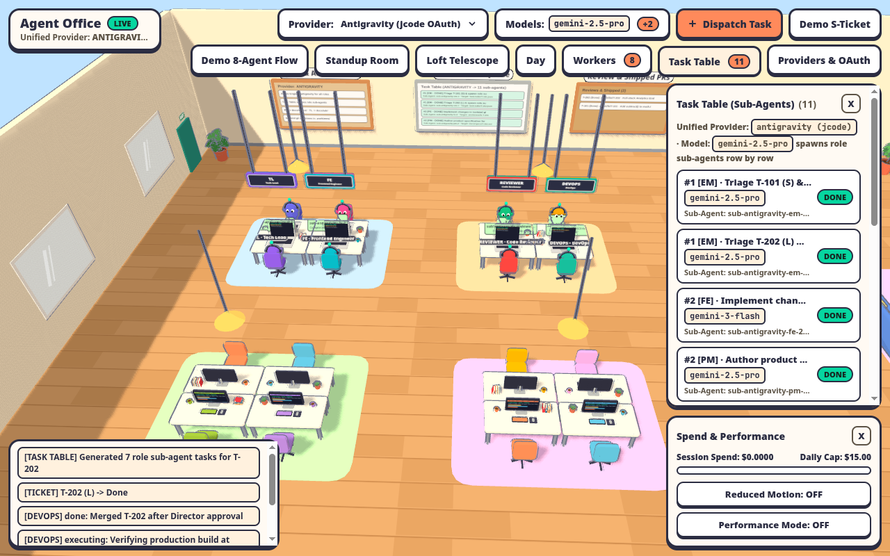
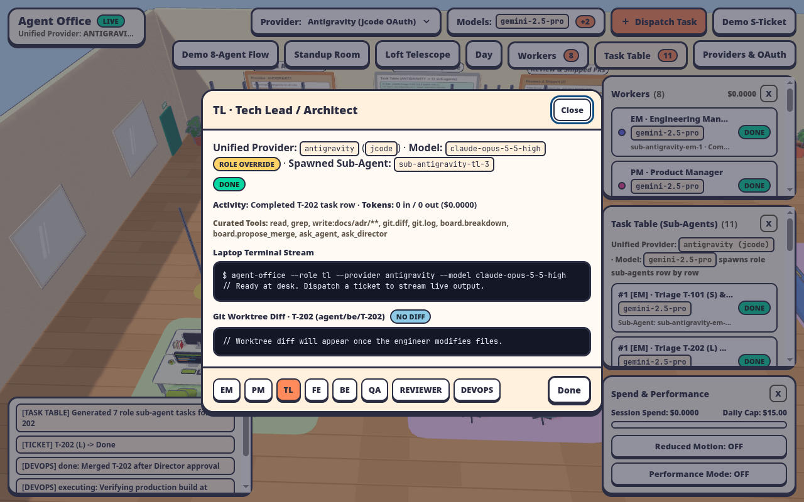
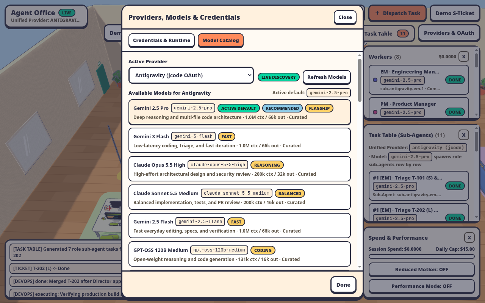

# Agent Office

Agent Office is a self-hosted 3D multi-agent software engineering workspace where a single configured AI provider executes development tickets across 8 role-specialized sub-agents (`em`, `pm`, `tl`, `fe`, `be`, `qa`, `reviewer`, `devops`) inside isolated Git worktrees. A Three.js cel-shaded 3D scene and a keyboard-accessible 2D HUD render live tool execution, terminal streams, worktree diffs, and Director approval gates over WebSocket.


## Architecture

The repository is an npm workspace monorepo organized around a hexagonal backend (`domain <- ports <- application <- adapters`, enforced by `scripts/arch-check.ts`), a shared protocol package, a React 18 + Three.js web client, and a Blender glTF asset pipeline.

| Path | Layer / Role | Responsibility |
|---|---|---|
| `packages/protocol/` | Shared Contract | Zod schemas (`schemas.ts`), initial snapshot factory (`state.ts`), and pure event reducer (`reducer.ts`) for 13 `AgentEvent` variants, `Ticket`, `TaskTableRow`, `ModelCatalogEntry`, and `OfficeConfig`. |
| `apps/server/src/domain/` | Pure Domain | Ticket workflow state machine (`ticket-machine.ts`), 3-tier shell command policy engine (`command-policy.ts`), provider registry (`providers.ts`), curated model catalog (`model-catalog.ts`), and role tool curation (`roles.ts`). Zero Node I/O imports. |
| `apps/server/src/ports/` | Hexagonal Ports | Interfaces for `AgentRuntimePort`, `EventStorePort`, `WorkspacePort`, `SecretStorePort`, and `ModelDiscoveryPort`. |
| `apps/server/src/application/` | Application Services | `OfficeOrchestrator` (`orchestrator.ts`), `TaskTable` generator (`task-table.ts`), coalesced stage runner (`stage-runner.ts`), and standup coordinator (`standup.ts`). |
| `apps/server/src/adapters/` | Infrastructure Adapters | `SQLiteOfficeStore` (`node:sqlite` WAL + `StatementSync` + AES-256-GCM secrets), `GitWorktreeAdapter` (`.worktrees/<role>-<ticketId>`), HTTP/WS server (`http/server.ts`), live model discovery (`runtimes/model-discovery.ts`), and runtime adapters (`scripted`, `jcode`, `ai-sdk`, `claude-agent-sdk`, `codex-sdk`). |
| `apps/web/src/scene/` | 3D WebGL Scene | `OfficeCanvas.tsx` (on-demand render loop, `ToonOutlineEffect`, Performance Mode, raycasting), `toon.ts` (3-step cel-shading ramp and static world merge), `toon-outline.ts` (instancing-aware outline pass), `toon-actors.ts` (`ToonWorkerPool`, `ToonLaptopPool`, merged `OfficeDog`, instanced `ConfettiSystem`), `models.ts`, `nav-and-intent.ts` (Grid A* and `IntentQueue`), and modular room builders in `world/` (`static-atlas.ts`, `architecture.ts`, `furniture.ts`, `boards.ts`, `world-builder.ts`). |
| `apps/web/src/components/` | 2D Accessible HUD | 19 focused modules (`TopBar`, `HudDock`, `SidePanel`, `WorkersPanel`, `WorkerRow`, `TaskTablePanel`, `SpendPanel`, `EventFeed`, `ApprovalDock`, `DispatchTicketModal`, `AgentInspectorModal`, `ProvidersModal`, `ModelCatalogTab`, `ModalDialog`, `useModalFocusTrap`, `TelescopeOverlay`, `LoadingOverlay`, `ErrorBanner`, `format-event.ts`). |
| `apps/web/src/store/` | Client State | Zustand store (`office-store.ts` with `56 ms` streaming batch coalescing and `performanceMode`), WebSocket/REST transport (`office-transport.ts`), provider catalog (`provider-catalog.ts`), and default role descriptors (`default-roles.ts`). |
| `assets/` | 3D Asset Pipeline | Headless Blender Python builders (`assets/scripts/build_*.py`, `export_all.py`) and binary GLB budget verifier (`assets/scripts/check_budgets.ts`). |
| `scripts/` | Verification & Ops | Hexagonal dependency boundary checker (`arch-check.ts`) and online SQLite backup utility (`backup-sqlite.ts`). |

## Unified Provider and Task Table Model

Instead of requiring separate credentials for each desk, a single active provider (`snapshot.activeProvider`, defaulting to `antigravity` via `jcode` OAuth and switchable live from the top bar or `POST /api/provider`) drives every role seat in the office. That active provider carries an optional provider-wide default model override (`snapshot.activeModel`) and optional per-role overrides (`snapshot.roleModels` across `em`, `pm`, `tl`, `fe`, `be`, `qa`, `reviewer`, `devops`), resolving each sub-agent via `roleModels[role] ?? activeModel ?? providerDefaultModel` and clearing stale overrides when switching providers.

When a ticket is dispatched or a fixture is replayed, the orchestrator builds an ordered **Task Table** (`TaskTableRow[]`) tailored to the ticket size (`S`, `M`, `L`) and primary engineer role (`fe` or `be`):

1. **Size `S` (4 task rows):**
   - `#1 [EM]` (`sub-<provider>-em-1`): Triage request and generate Task Table (`task-table/<id>.json`).
   - `#2 [FE|BE]` (`sub-<provider>-<fe|be>-2`): Implement changes in isolated git worktree (`.worktrees/<role>-<id>`).
   - `#3 [REVIEWER]` (`sub-<provider>-reviewer-3`): Audit git diff and command security policy (`git diff main...agent/<id>`).
   - `#4 [DEVOPS]` (`sub-<provider>-devops-4`): Verify release build and request Director merge approval (`git merge agent/<id> -> main`).
2. **Size `M` (5 task rows):** Inserts `#4 [QA]` (`sub-<provider>-qa-4`) after Review to run verification tests in the QA worktree before DevOps merge gating.
3. **Size `L` (7 task rows):** Inserts `#2 [PM]` (`docs/specs/<id>.md`) and `#3 [TL]` (`docs/adr/<id>.md`) before implementation, followed by Review, QA, and DevOps release gating.



## Workspace Views and Controls

### Agent Inspector (Terminal Stream and Git Diff)

Clicking any 3D worker or any row in the **Workers** or **Task Table** panels opens the Agent Inspector dialog. It displays the active unified provider, the resolved model for the inspected role (`Role Override` or `Provider Default`, also shown in `WorkerRow` and `TaskTablePanel`), the spawned sub-agent ID (`sub-<provider>-<role>-<order>`), token and USD usage, curated tool permissions, the live **Laptop Terminal Stream**, and the **Git Worktree Diff** for the active branch. Role tabs at the bottom support roving `ArrowLeft`, `ArrowRight`, `Home`, and `End` keyboard navigation.



### Standup Meeting Room

Activating **Standup Room** in the top dock triggers `POST /api/standup`, transitions the camera to the glass-walled meeting room, opens the proximity-activated sliding glass doors as all 8 workers walk from their desks to their meeting chairs, and updates the meeting room whiteboard with an active ticket summary.


### Director Loft Telescope

Activating **Loft Telescope** moves the camera to the brass tripod telescope in the elevated Director Loft overlooking the main office floor and renders a reticle overlay closable via the button or `Escape`.


### Providers, Models, and OAuth Settings

The top-bar **Models** quick-access button displays the active default model (plus any role override count) and opens the **Providers, Models & Credentials** dialog directly to the **Model Catalog** tab. A synchronized **Providers & OAuth** button opens the **Credentials & Runtime** tab, and an accessible `role="tablist"` header switches between both tabs:

- **Credentials & Runtime:** Configures the single active provider (`Active Provider` and `Execution Runtime`), probes readiness (`jcode` OAuth status or encrypted SQLite API key), summarizes the active model configuration, and keeps inactive providers inside a collapsible section.
- **Model Catalog:** Browses curated and optionally live-discovered models per provider (`GET /api/providers/:id/models`), sets a provider-wide default or custom model ID, assigns optional per-role overrides across all 8 roles (`em`, `pm`, `tl`, `fe`, `be`, `qa`, `reviewer`, `devops`), and provides a one-click **Reset all roles to provider default** action.




### Night Mode, Performance Mode, and Accessibility

Toggling **Day / Night** switches both the 2D HUD palette (`data-theme="day"` / `data-theme="night"`) and the 3D scene sky, fog, directional sun/moon lighting, and wooden floor plank tones. All Day and Night foreground/background and interactive border pairs pass WCAG 2.2 AA contrast thresholds (`>= 4.5:1` for normal text, `>= 3.0:1` for large text and non-text UI boundaries). Modals trap and restore keyboard focus, the layout reflows without horizontal overflow at 200% browser zoom (`640x400`) and mobile viewports (`320x568`), **Performance Mode** (`Spend & Performance` panel) disables `ToonOutlineEffect` and dynamic shadows while capping `devicePixelRatio` at `1` for low-end GPUs, and **Reduced Motion** (or OS `prefers-reduced-motion: reduce`) freezes continuous 3D animations and settles the WebGL render loop to `0 Hz` when idle.


## Computing and Rendering Performance

The 3D scene, React/Zustand HUD, and backend event pipeline are optimized to keep WebGL draw calls below `100/frame` and minimize CPU, GPU, memory, and network usage:

- **Static World Merging, `StaticSignAtlas`, and Instanced Actor Pools (`< 100` Draw Calls/Frame):** All 32 immutable text/monitor/sign planes are packed into a single `2048x1024` `StaticSignAtlas` mesh (`1` draw call); static room/desk/chair/prop geometries are merged by material (`mergeStaticWorld`); all 8 workers and 8 laptops render through `InstancedMesh` pools (`ToonWorkerPool` and `ToonLaptopPool` with a `4x2` `CanvasTexture` screen atlas); `dog-corgi.glb`'s 9 primitives are merged into 1 vertex-colored `SkinnedMesh`; and `ConfettiSystem` uses 1 pre-allocated `InstancedMesh`. Together with `ToonOutlineEffect` (instancing-aware outline pass that skips `noOutline` materials and hides sprites during outlining), WebGL draw calls per frame dropped from `1,838` at original baseline (`687-712` after M1) to **`64.43` at idle**, **`75.18` during active orbit**, and **`96.52` during active workflow streaming (`-86.5%` to `-96.5%`)**.
- **Performance Mode (`48.39` Draw Calls/Frame):** Enabling **Performance Mode** in the `Spend & Performance` panel (`localStorage`-persisted) disables the outline post-pass and dynamic shadow maps and caps `devicePixelRatio` to `1.0` (`1.5` in standard mode), running active camera orbits at **`48.39` draw calls/frame** with `0` shadow passes.
- **Idle Loop Throttling and Hidden-Tab Suspension:** When no camera movement, walking, or active tool animation is running, the render loop drops to a `1 Hz` background tick. When the browser tab is hidden (`document.visibilityState === "hidden"`) or Reduced Motion is enabled at rest (including immediately after an orbit drag ends), `requestAnimationFrame` halts completely (`0` rAF/sec, `0` draw calls/sec, `0` texture uploads/sec).
- **Dirty-Checked Textures, Throttled Shadows, and `56 ms` Zustand Batching:** Wall boards, laptop screens (`~7 Hz`), and speech-bubble sprites (`~6.7 Hz`) upload to WebGL textures only when content changes (`-88.9%` `texSubImage2D` calls during streaming). Directional `1024x1024` shadow maps refresh at `<= 10 Hz` only while actors move. High-frequency `agent.text` and `usage` WebSocket frames coalesce in `56 ms` micro-batches on the client (`-68.0%` DOM mutations), and closed modals unmount so their selectors do not run during streaming.
- **Deterministic GPU Resource Disposal:** Unmounting `OfficeCanvas` disposes all instanced and static geometries, materials, textures, shadow maps, and `ToonOutlineEffect` shader caches (`105/105` WebGL buffers released on unmount; initial buffer allocations reduced from `819` to `105`, `-87.2%`).
- **Vendor Bundle Splitting and Pruned 3D Assets:** Vite splits `three-vendor` (`643.1 KB`), `react-vendor` (`143.5 KB`), and application code (`192.2 KB`). Pruning unused dog breed GLBs reduced `public/models/` from `3.31 MB` to `1.31 MB` (`-60.4%`).
- **SQLite WAL Prepared Statements and Stream Coalescing:** Enabling `PRAGMA journal_mode = WAL`, `PRAGMA synchronous = NORMAL`, cached `StatementSync` statements, and `50 ms` `agent.text` delta coalescing in `stage-runner.ts` reduced 200-delta persistence and broadcast time from `28.40 ms` (`200` WS frames, `47,780 B`) to `5.69 ms` (`23` WS frames, `16,540 B`, `5.0x` faster and `-88.5%` frames).

## Setup and Usage

### Prerequisites

- **Node.js `>= 22.6`** (verified on `v26.13.1`; uses built-in `node:sqlite` and native TypeScript execution)
- **npm `>= 10`** and **Git `>= 2.30`**
- **Optional:** `jcode` CLI (`jcode -p antigravity` or `jcode -p openai` for OAuth-backed execution)
- **Optional:** Blender `>= 4.0` (verified on `5.3.0`, required only when regenerating `.glb` assets from `assets/scripts/*.py`)

### Build and Start (Production Mode)

```bash
npm install
npm run build
npm start
```

Open `http://127.0.0.1:4173` in a browser. The single process serves the built web client, the 7 `.glb` models, the REST API, and the `/ws` WebSocket stream.

### Development Mode

Run the backend watcher (`127.0.0.1:4173`) and Vite dev server (`127.0.0.1:5173`, proxying `/api` and `/ws` to `:4173`) in separate terminals:

```bash
npm run dev:server
npm run dev:web
```

### HTTP and WebSocket Endpoints

| Method and Path | Description |
|---|---|
| `GET /api/health` | Returns `{ ok: true, service: "agent-office-server", ts }`. |
| `GET /api/state` | Returns `{ state: OfficeStateSnapshot, roles: RoleConfig[] }`. |
| `GET /api/settings` | Returns active provider/runtime/model/roleModels, boolean presence of encrypted API keys (`configuredKeys`), and `jcode` OAuth readiness (`jcodeAuth`). Never returns raw secret values. |
| `GET /api/models` | Returns curated and optionally live-discovered model catalogs (`source: "curated" \| "live"`) for all 6 providers plus active default model and `roleModels` (`?refresh=1` bypasses TTL cache). |
| `GET /api/providers/:id/models` | Returns the curated/live-discovered `ProviderModelCatalog` for a single provider ID (`?refresh=1` optional). |
| `POST /api/settings/secrets` | Encrypts and stores `{ keyName, value }` in SQLite (`ANTHROPIC_API_KEY`, `OPENAI_API_KEY`, `KIMI_API_KEY`, `GEMINI_API_KEY`) and clears model discovery cache. |
| `POST /api/provider` | Switches the unified office provider (`{ provider, runtime?, model?, roleModels? }`), emits `provider.changed`, and re-syncs active Task Table rows. |
| `POST /api/provider/models` | Updates active provider default model, partial `roleModels` overrides, or `resetRoles` (`PATCH /api/provider/models` and `POST /api/models` also supported) and emits `provider.changed`. |
| `POST /api/tickets` | Dispatches a ticket (`{ title, description, size: "S"\|"M"\|"L", authorRole: "fe"\|"be", mode: "scripted"\|"live", autoApproveMerge? }`). |
| `POST /api/approvals/:reqId` | Resolves a pending Director approval gate (`{ approved: boolean, note? }`). |
| `POST /api/standup` | Emits `standup.summary` and gathers all 8 workers in the meeting room. |
| `POST /api/fixtures/:name` | Replays a deterministic JSONL fixture (`s-ticket`, `l-ticket-handoff`, `escalation`) and populates the Task Table. |
| `WS /ws` | Pushes `{ type: "snapshot", state, roles }` on connect followed by `{ type: "event", event: AgentEvent }` frames. |

## Configuration

Runtime defaults live in `office.config.yaml` and are validated against `OfficeConfigSchema` on startup.

### Supported Providers

| Provider ID | Auth Mode | Default Runtime | Env Key / CLI Source | Default Model |
|---|---|---|---|---|
| `antigravity` | `jcode-oauth` | `jcode` | `jcode -p antigravity` | `gemini-2.5-pro` |
| `claude` | `api-key` | `ai-sdk` | `ANTHROPIC_API_KEY` | `claude-sonnet-4-5-20250929` |
| `openai_oauth` | `jcode-oauth` | `jcode` | `jcode -p openai` | `gpt-5.4` |
| `openai_api` | `api-key` | `ai-sdk` | `OPENAI_API_KEY` | `gpt-4.1` |
| `kimi_code` | `api-key` | `ai-sdk` | `KIMI_API_KEY` (`https://api.kimi.com/coding/v1`) | `kimi-for-coding` |
| `gemini` | `api-key` | `ai-sdk` | `GEMINI_API_KEY` | `gemini-2.5-flash` |

### Environment Variables

| Variable | Purpose | Default |
|---|---|---|
| `HOST` | Bind address for HTTP/WS server. Non-loopback binding requires `OFFICE_ACCESS_TOKEN`. | `127.0.0.1` |
| `PORT` | HTTP/WS listen port. | `4173` |
| `OFFICE_ACCESS_TOKEN` | Bearer token required on all HTTP and `/ws` requests when `HOST` is non-loopback (or whenever set). | Unset on loopback |
| `OFFICE_MASTER_KEY` | Passphrase mixed with `os.hostname()` via `crypto.scryptSync` to derive the AES-256-GCM key for SQLite secrets. | `"agent-office-local-default-key"` |

### 3D Asset Pipeline

The 7 glTF binary models in `apps/web/public/models/` (`office_kit.glb`, `character_base.glb`, `desk_props.glb`, `kitchen.glb`, `lounge.glb`, `plants.glb`, `dog-corgi.glb`) are validated against file-size, node-count, and animation-clip budgets via:

```bash
npm run assets:check
```

To regenerate `office_kit.glb` and `character_base.glb` with headless Blender:

```bash
npm run assets:export
```

## Security Model

1. **Loopback Binding and Bearer Auth Guard:** The server binds to `127.0.0.1` by default. Binding to a non-loopback interface without setting `OFFICE_ACCESS_TOKEN` throws an immediate startup error. When non-loopback, WebSocket upgrades also validate the `Origin` header host.
2. **Three-Tier Shell Command Policy (`apps/server/src/domain/command-policy.ts`):** Every direct host shell command is split across compound operators (`;`, `&&`, `||`, `|`, `&`, newlines) and evaluated against:
   - `Deny`: Destructive or privilege-escalation patterns (`rm -rf /`, `rm -rf ~`, `sudo`, `mkfs`, `dd if=`, `curl ... | sh`, `wget ... | bash`, `chmod 777`, `git push --force`,fork bombs, and paths escaping the ticket worktree via `..`).
   - `Ask`: Network downloads, package installs, process termination, arbitrary redirections (`>`, `<`), or commands outside the role's `allowCommands` list pause execution and open a Director approval request in the HUD.
   - `Allow`: Read-only inspection and role-whitelisted commands inside the isolated worktree run without interruption.
3. **Role Tool Scoping and Worktree Isolation:** Each role only receives tools matching its `office.config.yaml` allowlist (`canRoleUseTool`, including path-prefix globs such as `write:docs/specs/**`). File writes and commands execute inside `.worktrees/<role>-<ticketId>` on branch `agent/<ticketId>`, never on the main working tree.
4. **Encrypted Secrets and Child Environment Scrubbing:** API keys saved via `/api/settings/secrets` are encrypted with AES-256-GCM (`12-byte` random IV + `16-byte` auth tag). Child processes spawned by `GitWorktreeAdapter` or `JcodeRuntimeAdapter` strip `ANTHROPIC_API_KEY`, `OPENAI_API_KEY`, `KIMI_API_KEY`, `GEMINI_API_KEY`, `OFFICE_MASTER_KEY`, and `OFFICE_ACCESS_TOKEN` from `process.env`.

## Verification Commands

```bash
npm run build        # Build production web bundle and run tsc --noEmit across all workspaces
npm run typecheck    # Run strict TypeScript typecheck across protocol, server, and web
npm run arch:check   # Verify hexagonal architecture dependency direction
npm run assets:check # Verify all 7 GLB models against byte budgets and animation clip requirements
npm test             # Run all 38 unit and integration test suites
npm run db:backup    # Create an online SQLite backup in .office-data/backups/
```
