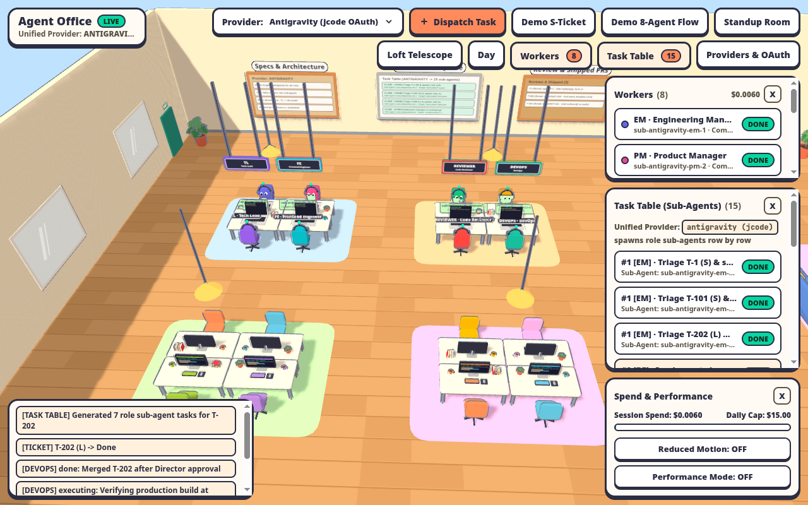
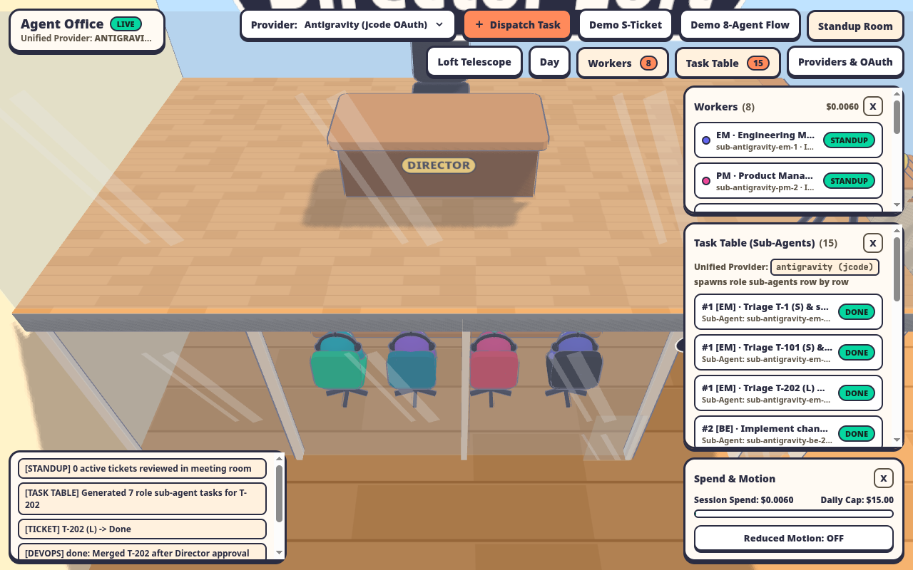
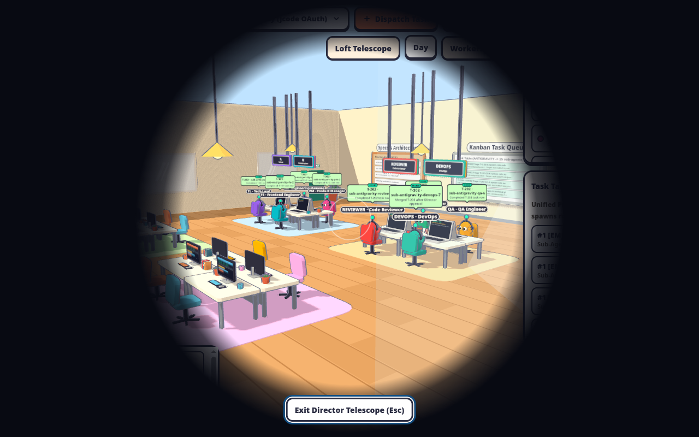
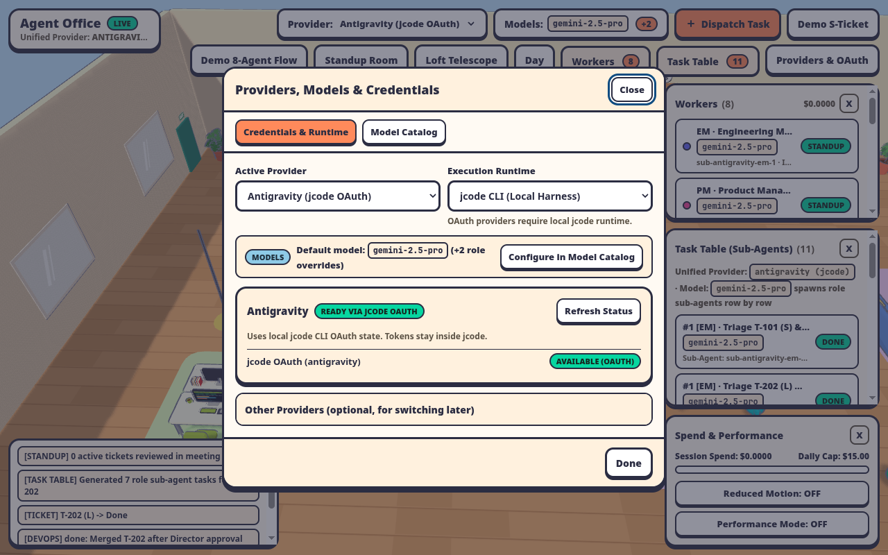
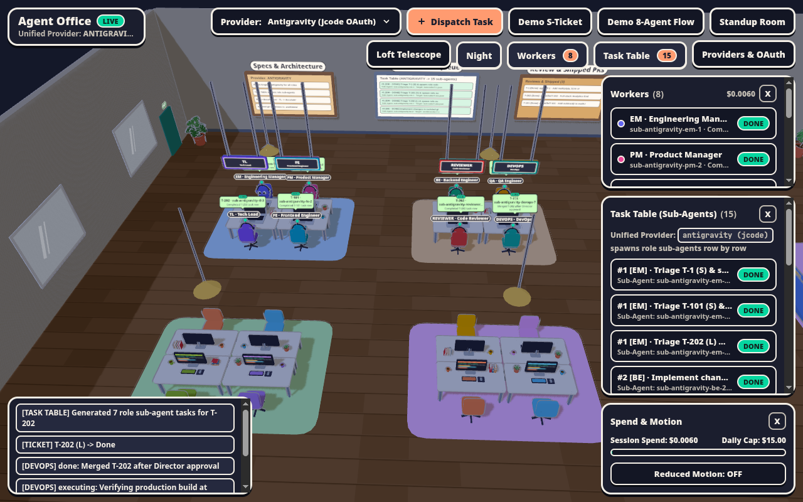

# Agent Office

Agent Office is a self-hosted 3D workspace for running multi-agent software tasks on a local machine. One configured AI provider powers all 8 engineering roles (`em`, `pm`, `tl`, `fe`, `be`, `qa`, `reviewer`, `devops`), each working inside an isolated Git worktree. A Three.js cel-shaded 3D scene and a React HUD built with Astryx (`@astryxdesign/core`) display live tool calls, terminal output, worktree diffs, and Director approval gates over WebSocket.



## Architecture

The repository is an npm workspace monorepo. The backend follows hexagonal boundaries (`domain <- ports <- application <- adapters`), checked automatically by `scripts/arch-check.ts`.

| Path | Layer | Responsibility |
|---|---|---|
| `packages/protocol/` | Shared contract | Zod schemas (`schemas.ts`), initial snapshot builder (`state.ts`), and pure event reducer (`reducer.ts`) covering 13 `AgentEvent` variants, `Ticket`, `TaskTableRow`, `ModelCatalogEntry`, and `OfficeConfig`. |
| `apps/server/src/domain/` | Domain | Ticket state machine (`ticket-machine.ts`), shell command policy (`command-policy.ts`), provider registry (`providers.ts`), curated model catalog (`model-catalog.ts`), and role tool rules (`roles.ts`). Contains no Node I/O imports. |
| `apps/server/src/ports/` | Ports | Interfaces for `AgentRuntimePort`, `EventStorePort`, `WorkspacePort`, `SecretStorePort`, and `ModelDiscoveryPort`. |
| `apps/server/src/application/` | Application | `OfficeOrchestrator` (`orchestrator.ts`), `TaskTable` builder (`task-table.ts`), coalesced stage runner (`stage-runner.ts`), and standup flow (`standup.ts`). |
| `apps/server/src/adapters/` | Adapters | `SQLiteOfficeStore` (`node:sqlite` WAL mode, prepared `StatementSync`, AES-256-GCM secrets), `GitWorktreeAdapter` (`.worktrees/<role>-<ticketId>`), HTTP and WebSocket server (`http/server.ts`), live model discovery (`runtimes/model-discovery.ts`), and runtime adapters (`scripted`, `jcode`, `ai-sdk`, `claude-agent-sdk`, `codex-sdk`). |
| `apps/web/src/scene/` | 3D scene | `OfficeCanvas.tsx` (on-demand WebGL loop, adaptive frame pacing, raycasting), `toon.ts` (3-step cel shading and static geometry merging), `toon-outline.ts` (instancing-aware outline pass and layer-1 overlay pass), `toon-actors.ts` (`ToonWorkerPool`, `ToonLaptopPool`, merged `OfficeDog`, `ConfettiSystem`), `models.ts`, `nav-and-intent.ts` (grid A* and `IntentQueue`), and room builders under `world/`. |
| `apps/web/src/components/` | 2D HUD | 18 React modules built on `@astryxdesign/core` and `lucide-react` (`TopBar`, `HudDock`, `SidePanel`, `WorkersPanel`, `WorkerRow`, `TaskTablePanel`, `SpendPanel`, `EventFeed`, `ApprovalDock`, `DispatchTicketModal`, `AgentInspectorModal`, `ProvidersModal`, `ModelCatalogTab`, `ModalDialog`, `TelescopeOverlay`, `LoadingOverlay`, `ErrorBanner`, `format-event.ts`). |
| `apps/web/src/themes/agent-office/` | Theme | Custom `agent-office` Astryx theme (`agentOfficeTheme.ts`) extending `@astryxdesign/theme-stone`, compiled into `agent-office.css` and `agent-office.js`. |
| `apps/web/src/store/` | Client state | Zustand store (`office-store.ts` with 56 ms streaming batching and Low GPU persistence), WebSocket/REST client (`office-transport.ts`), provider catalog helpers (`provider-catalog.ts`), and default roles (`default-roles.ts`). |
| `assets/` | 3D assets | Headless Blender Python builders (`assets/scripts/build_*.py`, `export_all.py`) and GLB budget checker (`assets/scripts/check_budgets.ts`). |
| `scripts/` | Tooling | Architecture boundary checker (`arch-check.ts`) and online SQLite backup script (`backup-sqlite.ts`). |

## Single-provider execution and task table

You configure one active provider for the whole office (`snapshot.activeProvider`, defaulting to `antigravity` via `jcode` OAuth). You can switch it live from the top command bar or through `POST /api/provider`. Each active provider supports an optional default model override (`snapshot.activeModel`) and per-role overrides (`snapshot.roleModels`). The server resolves each role using `roleModels[role] ?? activeModel ?? providerDefaultModel` and clears old role overrides when you switch to a different provider.

Dispatching a ticket or replaying a fixture creates an ordered Task Table (`TaskTableRow[]`) matched to the ticket size (`S`, `M`, or `L`) and primary engineer (`fe` or `be`):

1. Size `S` generates 4 rows: EM triage (`task-table/<id>.json`), FE or BE implementation in `.worktrees/<role>-<id>`, Reviewer diff audit (`git diff main...agent/<id>`), and DevOps build verification plus Director merge approval (`git merge agent/<id> -> main`).
2. Size `M` generates 5 rows, adding a QA verification step in the QA worktree between Review and DevOps.
3. Size `L` generates 7 rows, adding PM specification (`docs/specs/<id>.md`) and TL architecture notes (`docs/adr/<id>.md`) before implementation, followed by Review, QA, and DevOps.


## Interface and controls

The 2D HUD uses `@astryxdesign/core` components styled with the `agent-office` theme in light (Day) and dark (Night) modes. A single top command bar (`TopBar` and `HudDock`) holds the connection status pill, active provider selector, active model shortcut, 3-way camera switcher (`Office`, `Standup`, `Loft`), primary `Dispatch` button, `Demos` menu, settings button, Day/Night switch, and right drawer toggle.

On the right, a collapsible workspace drawer (`SidePanel`) groups the `Workers` and `Tasks` tabs above a compact footer (`SpendPanel`) with the session spend meter, `Reduced motion` switch, and `Low GPU` switch. A bottom-left `Activity` ticker (`EventFeed`) shows the 2 latest events by default and expands to 10 on click. When an agent hits an approval gate, a floating `ApprovalDock` appears at the bottom center. Approving or denying resolves both live runs and replayed fixture approvals cleanly.

### Agent inspector

Click any 3D worker or any row in the Workers or Tasks tab to open the Agent Inspector dialog. A role tab strip across the top switches between all 8 seats. Below it, the dialog shows the active provider and runtime, resolved model (marked as default or override), sub-agent ID (`sub-<provider>-<role>-<order>`), token and USD totals, allowed tool chips, a copyable Laptop Terminal Stream, and a syntax-highlighted Git Worktree Diff.


### Standup room and Director loft

Selecting `Standup` in the top camera switcher calls `POST /api/standup`, moves the camera to the glass meeting room, opens the proximity-triggered sliding doors as all 8 workers walk to their chairs, and updates the meeting whiteboard with active ticket details.



Selecting `Loft` shifts the camera to the tripod telescope in the elevated Director Loft overlooking the main floor. Press `Escape` or click `Exit Telescope` to return to the overview camera.



### Providers, credentials, and model catalog

The settings modal (`Providers, Models & Credentials`) splits into two tabs:

- Credentials & Runtime picks the active provider and execution runtime, probes `jcode` OAuth status or encrypted SQLite API keys, summarizes the active default model, and tucks inactive providers into a collapsible section.
- Model Catalog lists curated and live-discovered models (`GET /api/providers/:id/models`), sets a provider default or custom model ID, configures per-role overrides across all 8 roles, and offers a one-click reset back to the provider default.




### Day/Night themes, visibility, and accessibility

Switching Day and Night modes updates the Astryx theme tokens (`mode="light"` / `mode="dark"`) together with the 3D sky, fog, sun/moon lighting, and floor tones. Foreground and border tokens meet WCAG 2.2 AA contrast ratios in both modes. Astryx `Dialog` handles modal focus trapping and Escape dismissal, while the HUD layout adapts across desktop and narrow viewports without horizontal overflow.

In the 3D scene, overhead desk signs use double-sided 45-degree pitched canopy boards, and worker nametags and speech bubbles render on Three.js layer 1 with `depthTest = false` so labels stay legible even when looking straight down from an isometric angle.



## Rendering and runtime performance

Several changes keep CPU, GPU, and WebSocket overhead low during both active runs and idle viewing:

- Static room geometry and props merge by material (`mergeStaticWorld`), and all 32 static text, monitor, and desk signs pack into a single `2048x1024` `StaticSignAtlas` mesh. The 8 workers and 8 laptops render through `InstancedMesh` pools (`ToonWorkerPool`, `ToonLaptopPool`), the corgi (`dog-corgi.glb`) merges its 9 primitives into 1 `SkinnedMesh`, and `ConfettiSystem` reuses 1 pre-allocated `InstancedMesh`.
- When the scene is idle or the browser tab is hidden, `requestAnimationFrame` stops completely (`0 Hz`). During active work or camera drags, frame pacing adapts automatically: standard mode caps at 60 FPS while interacting and 30 FPS for ambient updates (DPR capped at `1.25`), while `Low GPU` mode caps at 30 FPS interactive / 15 FPS ambient, disables outlines and shadows, disables WebGL antialiasing on init, and caps DPR at `1.0`.
- Worker instance matrices skip GPU uploads when `matricesDirty` is false. Directional `768x768` shadow maps refresh at most every `350 ms` while actors move. Laptop screen textures use `384x256` atlas cells (`anisotropy = 2`) with `300 ms` stream throttling, and wall boards and speech bubbles upload only when their content changes.
- Unmounting `OfficeCanvas` disposes all instanced and static geometries, materials, textures, shadow maps, and `ToonOutlineEffect` shader caches.
- Vite splits production bundles into `three-vendor` (`643.1 kB`), `astryx-vendor` (`1,019.8 kB` JS, `74.2 kB` CSS), `react-vendor` (`223.9 kB`), and application code (`225.5 kB` JS, `352.4 kB` CSS). The 7 runtime GLB models under `apps/web/public/models/` total `1.31 MB`.
- On the backend, SQLite runs in WAL mode (`PRAGMA synchronous = NORMAL`) with cached `StatementSync` statements. `stage-runner.ts` coalesces `agent.text` deltas over `50 ms` windows, and the Zustand store batches incoming streaming updates over `56 ms` windows while keeping closed modals unmounted.

## Setup and usage

### Prerequisites

- Node.js `>= 22.6` (uses built-in `node:sqlite` and native TypeScript execution)
- npm `>= 10` and Git `>= 2.30`
- Optional: `jcode` CLI (`jcode -p antigravity` or `jcode -p openai`) for OAuth-backed live runs
- Optional: Blender `>= 4.0` if you regenerate `.glb` files from `assets/scripts/*.py`

### Production build and start

```bash
npm install
npm run build
npm start
```

Open `http://127.0.0.1:4173`. One Node process serves the built frontend, the 7 `.glb` models, the REST API, and `/ws`.

### Development servers

Run the backend watcher (`127.0.0.1:4173`) and Vite dev server (`127.0.0.1:5173`, proxying `/api` and `/ws` to `:4173`) in separate terminals:

```bash
npm run dev:server
npm run dev:web
```

### HTTP and WebSocket API

| Method and path | Behavior |
|---|---|
| `GET /api/health` | Returns `{ ok: true, service: "agent-office-server", ts }`. |
| `GET /api/state` | Returns `{ state: OfficeStateSnapshot, roles: RoleConfig[] }`. |
| `GET /api/settings` | Returns active provider, runtime, model, `roleModels`, boolean flags for stored API keys (`configuredKeys`), and `jcode` OAuth status (`jcodeAuth`). Never exposes raw secrets. |
| `GET /api/models` | Returns curated or live-discovered catalogs (`source: "curated" \| "live"`) for all 6 providers plus active default model and `roleModels` (`?refresh=1` bypasses cache). |
| `GET /api/providers/:id/models` | Returns `ProviderModelCatalog` for one provider (`?refresh=1` optional). |
| `POST /api/settings/secrets` | Encrypts and saves `{ keyName, value }` in SQLite (`ANTHROPIC_API_KEY`, `OPENAI_API_KEY`, `KIMI_API_KEY`, `GEMINI_API_KEY`) and clears the model discovery cache. |
| `POST /api/provider` | Switches the active provider (`{ provider, runtime?, model?, roleModels? }`), emits `provider.changed`, and resyncs active Task Table rows. |
| `POST /api/provider/models` | Updates the active provider default model, partial `roleModels`, or `resetRoles` (`PATCH /api/provider/models` and `POST /api/models` also work) and emits `provider.changed`. |
| `POST /api/tickets` | Dispatches a ticket (`{ title, description, size: "S"\|"M"\|"L", authorRole: "fe"\|"be", mode: "scripted"\|"live", autoApproveMerge? }`). |
| `POST /api/approvals/:reqId` | Resolves a pending live or replayed Director approval gate (`{ approved: boolean, note? }`). |
| `POST /api/standup` | Emits `standup.summary` and sends all 8 workers to the meeting room. |
| `POST /api/fixtures/:name` | Replays a local JSONL fixture (`s-ticket`, `l-ticket-handoff`, `escalation`) and populates the Task Table. |
| `WS /ws` | Sends `{ type: "snapshot", state, roles }` on connect, followed by `{ type: "event", event: AgentEvent }` messages. |

## Configuration

Startup defaults live in `office.config.yaml` and are validated against `OfficeConfigSchema`.

### Supported providers

| Provider ID | Auth mode | Default runtime | Key or CLI source | Default model |
|---|---|---|---|---|
| `antigravity` | `jcode-oauth` | `jcode` | `jcode -p antigravity` | `gemini-2.5-pro` |
| `claude` | `api-key` | `ai-sdk` | `ANTHROPIC_API_KEY` | `claude-sonnet-4-5-20250929` |
| `openai_oauth` | `jcode-oauth` | `jcode` | `jcode -p openai` | `gpt-5.4` |
| `openai_api` | `api-key` | `ai-sdk` | `OPENAI_API_KEY` | `gpt-4.1` |
| `kimi_code` | `api-key` | `ai-sdk` | `KIMI_API_KEY` (`https://api.kimi.com/coding/v1`) | `kimi-for-coding` |
| `gemini` | `api-key` | `ai-sdk` | `GEMINI_API_KEY` | `gemini-2.5-flash` |

### Environment variables

| Variable | Purpose | Default |
|---|---|---|
| `HOST` | Bind address for HTTP and WebSocket traffic. Non-loopback hosts require `OFFICE_ACCESS_TOKEN`. | `127.0.0.1` |
| `PORT` | Listen port for HTTP and WebSocket traffic. | `4173` |
| `OFFICE_ACCESS_TOKEN` | Bearer token checked on HTTP and `/ws` requests whenever set (required when `HOST` is non-loopback). | Unset on loopback |
| `OFFICE_MASTER_KEY` | Passphrase mixed with `os.hostname()` via `crypto.scryptSync` to derive the AES-256-GCM key for SQLite secrets. | `"agent-office-local-default-key"` |

### 3D asset checks and export

Validate all 7 binary models in `apps/web/public/models/` (`office_kit.glb`, `character_base.glb`, `desk_props.glb`, `kitchen.glb`, `lounge.glb`, `plants.glb`, `dog-corgi.glb`) against byte-size, node-count, and animation clip budgets:

```bash
npm run assets:check
```

Regenerate `office_kit.glb` and `character_base.glb` with headless Blender:

```bash
npm run assets:export
```

## Security model

The server binds to `127.0.0.1` by default. Starting on a non-loopback `HOST` without `OFFICE_ACCESS_TOKEN` fails immediately at boot, and non-loopback WebSocket upgrades verify that the `Origin` header host matches.

`apps/server/src/domain/command-policy.ts` splits every shell command across compound operators (`;`, `&&`, `||`, `|`, `&`, newlines) and classifies each segment into one of three tiers:

- `Deny` blocks destructive and privilege-escalation commands (`rm -rf /`, `rm -rf ~`, `sudo`, `mkfs`, `dd if=`, `curl ... | sh`, `wget ... | bash`, `chmod 777`, `git push --force`, fork bombs, and paths escaping the worktree via `..`).
- `Ask` pauses execution and opens a Director approval card for network downloads, package installs, process termination, file redirections (`>`, `<`), or commands outside the role's `allowCommands` list.
- `Allow` runs read-only checks and role-whitelisted commands inside the worktree without prompting.

Each role only sees tools permitted in `office.config.yaml` (`canRoleUseTool`, including path globs such as `write:docs/specs/**`). File writes and commands run inside `.worktrees/<role>-<ticketId>` on branch `agent/<ticketId>`, leaving the main working tree untouched.

API keys saved via `/api/settings/secrets` are encrypted with AES-256-GCM (12-byte random IV and 16-byte auth tag). Child processes started by `GitWorktreeAdapter` or `JcodeRuntimeAdapter` strip `ANTHROPIC_API_KEY`, `OPENAI_API_KEY`, `KIMI_API_KEY`, `GEMINI_API_KEY`, `OFFICE_MASTER_KEY`, and `OFFICE_ACCESS_TOKEN` before spawning, injecting only the active API-key provider's secret when needed.

## Verification commands

```bash
npm run build        # Build web assets and run tsc --noEmit across all workspaces
npm run typecheck    # Typecheck protocol, server, and web workspaces
npm run arch:check   # Check hexagonal architecture dependency direction
npm run assets:check # Check all 7 GLB models against byte and clip budgets
npm test             # Run all 39 unit and integration tests
npm run db:backup    # Write an online SQLite backup to .office-data/backups/
```
